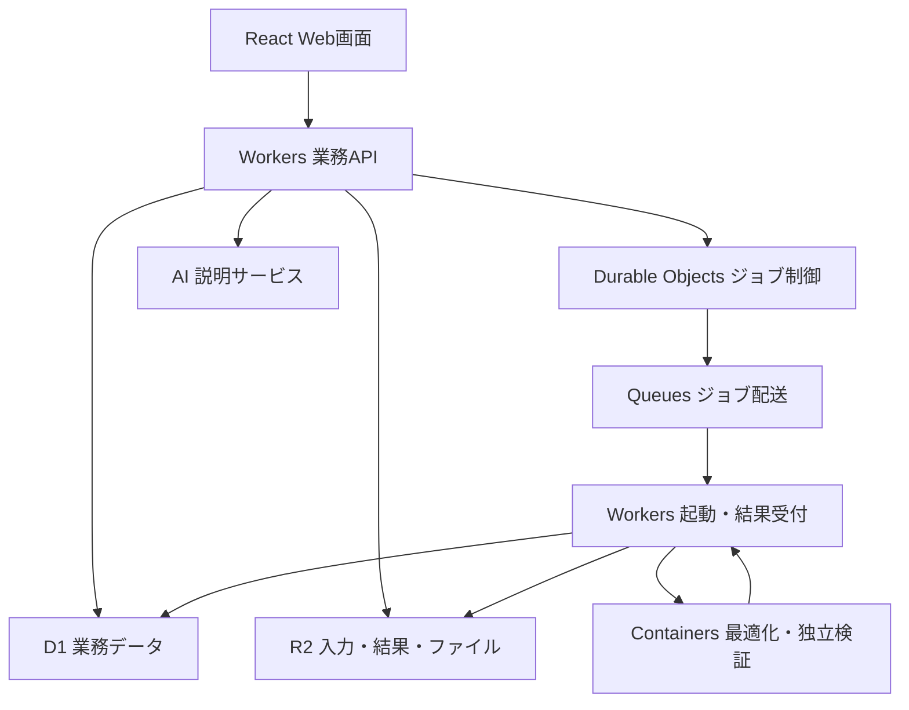

# シフト管理アプリ 技術スタック

2026-10-16追加改修：[ADR 0121](adr/0121-tailwind-shadcn-product-ui.md)によりTailwind CSS＋shadcn/uiを採用し、製品画面全体のニュートラルなテーマ・共通部品・余白・右下トースト・ロード中UIへ移行する。実施結果（過去の私有資料・公開対象外）でローカル確認と未検証範囲を記録する。今回の追加UIはCloudflareへ反映済み（過去の私有資料・公開対象外）。配信資産一致・4幅の余白とロード／通知表示を確認し、2026-10-15の凍結版MVP受入と今回の限定的な遠隔画面確認を区別する。

2026-10-15最終判定：合意済みのMVP開発対象の技術受入を完了。検証・配備版7a20d5bは同commitの固定11／security9、G0・G1独立承認、実Cloudflare4job／5attempt・17段階復旧・PC／モバイル画面・所有資格情報終了まで成功した。実測・未検証範囲・保留は最終結果（過去の私有資料・公開対象外）を参照。以下の日付付き追記は各時点の履歴として保持する。

2026-10-14：通常初期案優先のcalendar fallback（過去の私有資料・公開対象外）を通常コード設定へ採用。101人の通常品質維持・未取得条件の案取得、実SDKの検査／停止／採用／公開を確認。全Python858／全API577・型検査成功。複雑500人の性能改善は後続、Cloudflare反映・G0／G1正式判定は残る。

2026-10-14ユーザー決定：[ADR 0098](adr/0098-defer-complex-500-performance.md)により、複雑な500人条件の処理量・メモリ余裕の改善は今回のMVP範囲外。現時点の性能・制限を記録し、今後支障があれば対応する。R-01は案の品質評価と検証済み改善候補の通常経路への反映を継続する。必須条件・独立検証・状態分類・原子更新は維持する。

2026-10-14ユーザー決定：[ADR 0097](adr/0097-defer-operations-mail-ai.md)によりR-05「運用・メール・AI」は今回のMVP完成条件から外し、後続工程へ移す。今回の残対応はR-01／02／03／04／06／07の6項目。認証・権限、アプリ内通知、技術的な障害復旧と最終Cloudflare確認は維持し、運営体制・通常メール・AI評価・運用目標達成は完成の待ち条件にしない。製品仕様・既存実装と証跡は維持する。

2026-10-13ユーザー決定：[今回のMVP開発の納品範囲](adr/0072-mvp-development-delivery-scope.md)。実チームへの試験導入・現場評価（A3〜A4／G2、R-08）は今回の範囲外。今回の完成判定は製品実装・技術検証・G0／G1の技術的準備・運用手順・最終Cloudflare確認に限定し、未検証を合格にはしない。製品仕様を変更せず、後続の試験導入・G2は別工程として残す。試験チーム条件の回答は今回の開発前提にしない。

2026-10-13追記：希望休日ヒントの通常採用と検証（過去の私有資料・公開対象外）／[ADR 0070](adr/0070-checked-covered-off-hints.md)。従来初期値の一日分を完成後に、除去後の一般／役割充足・全ルールの月残量を保つ希望休日ヒントを通常profile `mvp-joint-covered-off-hints-v1`へ採用した。初期候補の論理選択不備・後続分母の反例は不採用として保持。修正版4条件と固定入力で先行不足・余剰を維持して希望101→80／500→379、実SDK101人で新profile／flag・3131行・別check・停止先行／保存／終了を確認した。実登録経路の一般不足30,000、固定入力の約0.64 GiB余裕、初回Proxy接続断、同源反復／異条件・全UI／復旧・G0〜G2は残る。Cloudflare追加0、最終一括・定期backup保留・30日保管を維持する。

- 作成日・更新日：2026年10月10日（日本時間）
- 版：0.1
- 状態：Cloudflareを利用する方針はユーザー指定。以下の製品構成は推奨案。A0〜A1の限定PoCを実施したが、製品全体の採用・性能達成・復旧検証は未確定。実施記録（過去の私有資料・公開対象外）と[ADR-0001](adr/0001-a0-a1-poc-foundation.md)で候補・実装・検証結果を区別する。
- 対象：1社・1チームのMVPから、101〜500人規模の本開発へ進む構成。
- 追加技術判断（2026-10-10）：[ADR-0002](adr/0002-reference-ui-and-free-devsecops.md)。参照モックを隔離して取り込み、無料OSS検査を導入。OR-Tools／Python更新版の確認範囲と旧版の実環境計測を区別する。

## 1. 位置付けと決定状況

本書は、AWSではなくCloudflareを利用したいという後続の指定と、その構成提案を文書化する。設計書Q41の「指定なし」は過去の回答として保持し、現在のクラウド方針には後続指定を適用する。AWSのサービスを標準構成には含めない。

| 区分 | 内容 |
| --- | --- |
| 確定方針 | Cloudflareを中心に構成する。MVPで検証してから本開発へ進む |
| 推奨構成 | React／TypeScript、Workers、D1、R2、Queues、Durable Objects、Containers、Python／OR-Tools |
| 採用前の検証 | コンテナの性能、D1の原子更新・競合、認証、費用、復旧、実行環境の互換性 |
| PoCで使用 | 固定した依存版、Workers Paid、Containers standard-2、D1、Better Authネイティブ接続。詳細はADR-0001。製品全体の採用は保留 |
| 後続で使用 | React／TypeScript／ViteとWorkers Assetsの業務画面を部分実装。メールはユーザー指定のResendを接続し、試験配送を確認。製品配送はdisabled |
| 未選定・未定 | 製品用資源量、メール送信元／認証済みドメイン、AIモデル、月次費用枠 |

製品の意味・制約は次の文書を正本とする。本書で勤務条件を緩和したり、MVP対象を拡大したりしない。

| 文書 | 参照内容 |
| --- | --- |
| [要件・設計書](shift_management_design.md) 0.12 | 製品要件、権限、Q01〜Q131、前月提出期限の補足、Cloudflare指定 |
| [最適化モデル詳細仕様書](shift_management_optimization_model.md) 0.2 | 変数、必須条件、評価順序、時間表現、独立検証 |
| [実装計画](shift_management_implementation_plan.md) 0.5 | A0〜A3のMVPと本開発の工程・範囲 |
| [テスト戦略](shift_management_test_strategy.md) 0.5 | 既存テスト観点、品質ゲート、検証証跡 |

## 2. 推奨スタック

| 領域 | 第一候補 | 選定理由・留意点 |
| --- | --- | --- |
| フロント | React + TypeScript + Vite | 管理者画面とスタッフ向けレスポンシブWebを共通の型で開発 |
| UI | Tailwind CSS + shadcn/ui | 共通部品を管理し、表・フォーム・ダイアログを統一。アクセシビリティは実装後に検証 |
| 大きな表 | TanStack Virtual | 月間シフトや日別配置の表示行・列を仮想化。500人の操作性は実測する [S12] |
| Web配信 | Workers Static Assets + Cloudflare Vite plugin | 静的画面とAPIをWorkers構成で開発・配信する [S01][S02] |
| 業務API | Workers + Hono + Zod／TypeScript | 認証・権限・入力検証・版管理・短い業務処理を担当 [S03] |
| DB | D1 + Drizzle ORM | MVPの第一候補。SQLiteの制約と更新方式を検証し、採用を判断する [S06][S07] |
| 認証 | Better Auth | メール・パスワード認証。初回変更必須はアプリ側の状態とAPI制御を追加 [S09][S10] |
| 最適化 | Python + OR-Tools CP-SAT | 月間勤務と業務配置を整数制約でモデル化。段階的な目的評価を実装 [S11] |
| 計算実行 | Cloudflare Containers／Linux Docker | OR-Toolsと独立チェッカーをコンテナで動かす。CPU・メモリ・起動時間を検証 [S04][S05] |
| 非同期制御 | Queues + Durable Objects | ジョブ配送、チーム単位の実行制御、再試行・重複排除 |
| ファイル | R2 | 取込元、出力、計算入力、結果・検証報告のオブジェクト保存 |
| AI | Workers AIまたは外部LLM API | 呼出しを抽象化し、説明・比較の要件と費用で選定 |
| テスト・CI | Vitest、pytest、Playwright、GitHub Actions | TypeScript、最適化・チェッカー、主要画面の役割に合わせて検証 |

現在の画面モックの実装方式は、本番スタックの採用・構築完了を意味しない。モックの導線・表示内容を参照し、APIと権限を持つ実装へ移行する。

2026-10-11の[ADR-0009](adr/0009-product-ui-and-static-assets.md)で、React 19.3.0／TypeScript 7.0.2／Vite 8.3.4と同一OriginのAPI接続を部分実装した。今回の配信は既存WranglerとASSETS bindingを使用し、Cloudflare Vite plugin、Tailwind／shadcn、TanStack Virtualは未導入。実コマンドはnpmで管理する。推奨候補と実装済み構成を区別し、500人の画面性能・実端末・全業務導線は未検証とする。実施記録（過去の私有資料・公開対象外）を参照。

## 3. 全体構成

この図は責務の提案であり、全サービス間に自動的なトランザクションや同一の認証方式があることを示さない。コンテナのライフサイクルは対応するDurable Objectsで制御する [S04]。チームのジョブ受付とコンテナ制御を同じオブジェクトにするかはPoCで決める。

PythonコンテナからD1・R2のWorkersバインディングをそのまま利用できるとは仮定しない。入力取得・結果受付は、ジョブに限定した認証付き内部HTTP APIまたは期限付きのオブジェクトアクセスで設計する。公開APIと内部APIの権限を分ける。

## 4. Web画面と業務API

管理者はPC、スタッフはスマートフォンのブラウザを中心に利用する。管理者の月間シフト・計算結果はタブで切り替え、月間の日付から日別業務配置、セルからスタッフ×日付の詳細をRadix Dialogで開く（[ADR 0136](adr/0136-schedule-info-and-day-dialogs.md)）。人数の多い表は仮想化し、選択・固定・エラー表示がスクロールで失われないことを確認する。

Workersはスタッフ・契約・スキル・需要・予定・希望の管理、申請・公開、ジョブ受付、結果参照を担当する。数分間の最適化をHTTPリクエスト内で実行せず、ジョブIDを返して進捗を取得する。

TypeScriptとPythonの境界は、版を付けたJSON Schema等の契約で定義する。ZodだけをPythonの検証仕様にせず、日時・整数分・能力係数・欠損と0・ID・列挙値を共通の入出力契約に記載する。ソルバー状態、必須条件の検証状態、入力版、評価値を別々に返す。

通常の業務枠は30分／60分、出退勤・休憩は30分単位とする。準備・移動・最低継続は整数分で正確に扱う。UIの枠に合わせて計算値を丸めない。勤務日は日本時間、監査時刻はタイムゾーンを明示した形式で保存する。

## 5. 最適化コンテナと独立検証

2026-10-11の[ADR 0010](adr/0010-company-break-rule.md)で、Q70の必要休憩ルールを企業共通の月別設定版へ集約した。計算入力は企業共通版を参照し、チーム版による上書き・旧値の自動移行を拒否する。旧凍結入力は保持する。ローカル115件の統合試験とフォームからの実計算を確認し、今回のCloudflare再配備・公開済み月の再検証は未実施と区別する。

通常のWorkersでOR-Toolsの実行互換性・計算資源を満たすことを前提にせず、LinuxコンテナにPython、OR-Tools、チェッカーを同梱する。ソルバーとチェッカーは別モジュールにし、制約生成コードをそのまま再利用して検証を済ませない。

2026年10月10日の公式仕様では、ContainersはWorkers有料プランが必要で、公開された最大構成は4 vCPU・12 GiBメモリである [S04][S05]。この資源で500人・暦月・分単位の条件を5分程度で処理できるかは未検証。全体モデルと段階モデルを比較し、CPU・メモリ・起動待ち・検証時間を記録する。

処理中はコンテナの停止条件と生存確認を管理する。ブラウザを閉じても計算が継続できる設計とし、入力・結果はR2に保存する。コンテナの一時ディスクだけに成果物を置かない。クラッシュ後の再試行はジョブID・試行番号で管理し、古い試行の結果で上書きしない。

CP-SATのOPTIMAL／FEASIBLE／INFEASIBLE／UNKNOWN／MODEL_INVALIDを区別する [S11]。FEASIBLEでも独立検証と履歴確認が必要であり、UNKNOWNを「解なし」と断定しない。目的の上位段階を証明できなかった場合の証明状況は詳細モデルに従って表示する。

需要・役割不足は評価対象であり、必須条件違反とは区別する。必須条件を守った案は不足があっても管理者が判断できる。AIやソルバーが案を自動採用・公開しない。

## 6. ジョブ受付・配送・結果の整合性

同一チームの通常計算は、受付済み・待機中・実行中を通じて1件までとする。異なるチームの同時実行数は費用と資源の検証後に決める。

1. 権限と入力を確認し、入力版・設定版・対象月を固定したスナップショットをR2へ保存する。
2. チームの受付を制御し、D1にジョブと配送待ちレコードを整合して記録する。
3. 配送待ちをQueuesへ送る。送信・受信の重複はジョブIDで処理する。
4. 起動担当Workerが実行権を確認し、コンテナを起動する。受信Worker自身ではソルバーを実行しない。
5. コンテナが最適化と独立検証を実行し、結果・検証報告を保存する。
6. 結果受付APIがジョブID・試行番号・入力版を照合し、状態を更新する。
7. 画面で検証済み案と評価・不足・証明状況を表示する。入力が変更されていれば古い案として扱い、現在の下書きや公開版を上書きしない。

Queuesの配送を一度限りと仮定しない [S14]。再配送・二重コールバック・送信後障害を想定し、期限付きの実行権と単調に増える試行番号で重複した結果反映を防ぐ。ジョブ受付はDB側でも競合を検知し、Durable Objectsだけを唯一の整合性根拠にしない。

タイムアウト、起動失敗、実行失敗、期限切れ、結果検証失敗を終端状態として整理する。復旧処理で実行権を解放し、同じチームが永続的に計算できなくなる状態を防ぐ。状態遷移・再試行回数・取消方式はADRとジョブ仕様で具体化する。

5分程度の目標は、操作開始から待機・起動・前処理・探索・独立検証・転送・表示までの総時間である。ソルバーだけに300秒を割り当てない。AI説明は別処理とする。シナリオ比較は元案＋代替1案で、同じチームの計算制御を経由して実行する。

## 7. D1・データモデル・原子更新

D1を第一候補とし、スタッフ、適用月付き契約・ルール、希望、勤務区間、業務区間、公開版、申請、通知、監査、ジョブのメタデータを保存する。全スタッフ×全分のセルを常時保存せず、勤務・業務・予定・準備等の区間と版で表現する。計算用に展開したデータはR2へ保存する。

2026年10月10日の公式仕様では、有料D1は1データベース10 GBまで、単一DBは単一スレッドでクエリを処理し、クエリ・バッチの実行時間にも制限がある [S06]。容量だけでなく、500人の入力・取得・保存、バッチの長さ、競合時の遅延を計測する。企業単位のDB分割を可能にする設計を検討するが、MVPで分割数を先に固定しない。

休暇承認・欠勤取消確定・公開では、参照した入力版と更新条件を一緒に検証する。取消、予定参加解除、公開データ、履歴、通知の配送待ちを、同じD1内で原子的に更新できることを採用条件とする。

D1の`batch()`はSQL失敗時にバッチ全体をロールバックする [S07]。ただし条件付きUPDATEが0行更新だっただけではSQL失敗にならない。版の不一致時に後続更新が残らないよう、制約・条件付きSQLを組み合わせ、全体の成功条件を検証する。単に事前SELECTしてから更新する方式を原子的とは扱わない。Sessionsによる読み取りの整合性も、複数リクエストの更新トランザクションと同一視しない。

最適化・長い検証中にDBトランザクションを保持しない。スナップショットに対して検証し、短い更新時に版と状態を再確認する。半日取消では最低勤務量、固定、公開済み休憩、Q131の自動休憩量一致を確認し、矛盾があれば取消の確定更新を行わない。

R2・Queues・D1をまたぐ原子トランザクションは前提にしない。必要なオブジェクトを先に保存し、D1で参照と配送待ちを確定する。送信失敗は再送し、未参照オブジェクトは後で整理する。通知は重複排除してアプリ内のお知らせへ反映する。

PoCで必要な原子更新・性能・容量が満たせない場合は、外部のマネージドPostgreSQL＋Hyperdriveを代替候補にする。Hyperdriveは接続を仲介するサービスでありDB本体ではない [S13]。Web・API・ジョブ・ファイルのCloudflare方針を維持し、変更理由と移行方法をADRへ記録する。

## 8. 認証・権限・通知

Better AuthのD1対応とメール・パスワード認証を利用候補とする [S09][S10]。採用版、Workersとの互換性、ネイティブD1接続とDrizzle経由の構成はPoCで確定する。

- サービス運営者が企業環境と最初の企業管理者を作成する。一般公開の自己登録は無効にする。
- 管理者が初期パスワードを発行し、本人が初回ログイン時に変更する。
- 初回変更必須の状態をアプリ側で管理する。ログイン済みでも変更完了まで業務APIへアクセスさせない。
- パスワードを忘れた本人は再設定メールを受け取る。トークン期限、使い捨て、漏えい・濫用防止を検証する。
- 企業管理者・チーム管理者・スタッフの権限を全APIとファイル・ジョブで検査する。
- 初期パスワード・再設定トークン・セッション秘密値をログやコミットに残さない。

再設定メールの送信サービスは2026-10-10のユーザー指定でResendを採用する方針とした。[ADR 0003](adr/0003-multi-task-and-resend.md)に配送コード・模擬検証・実送信未検証を区別して記録する。シフト公開・変更・申請結果の通知は既定どおりアプリ内とし、メール通知へ拡張したとは扱わない。

## 9. ファイルとAI

取込元のExcel／CSV、プレビュー処理用ファイル、確定シフトの出力、計算入力・結果・検証報告はR2を利用候補とする [S15]。企業・チーム権限を確認して取得させ、オブジェクト名の推測だけで他企業へアクセスできない設計とする。保存期間と削除条件は運用設計で決める。

MVPの取込・出力は実装計画のCSV中心の範囲を守る。Excel対応時はPythonライブラリ等で解析・生成し、サイズと処理時間で非同期化を判断する。確定出力は勤務日・出退勤・休憩を対象とし、業務配置や計算評価を勝手に追加しない。

AI-01は検証結果に基づく不足理由等の説明をMVPに入れ、AIを利用できない場合は定型表示へ切り替える。AI-02の元案＋代替1案の比較は本開発B3に対応させる。本番モデルは未選定。2026-10-11のPoCではWorkers AIの `@cf/meta/llama-3.3-70b-instruct-fp8-fast` を接続候補として確認した。呼出し契約を分離し、外部LLM APIとの比較は残る。

AIへ送る情報は必要な評価・根拠・仮名IDに絞る。氏名、メールアドレス、スタッフ全履歴を常に送る構成にしない。説明には入力版と結果版を付け、数理計算の結果から離れた推測を事実として表示しない。AI説明の遅延・障害はシフト案の表示を妨げない。

## 10. 開発・テスト・CI

| 対象 | 開発・検証候補 | 主な確認 |
| --- | --- | --- |
| Web・API | pnpm、TypeScript、Vite、Wrangler、Vitest | 型、入力、権限、表示、Workers実行環境 |
| 最適化・チェッカー | uv、Python、pytest、Docker | 小規模の正解比較、必須条件、評価順序、整数分、状態分類 |
| 主要導線 | Playwright | 希望提出、計算、固定、公開、休暇・欠勤、モバイル操作 |
| DB・ジョブ | ローカル検証＋Cloudflare検証環境 | マイグレーション、版競合、ロールバック、重複配送、クラッシュ |
| CI | GitHub Actions | 構成に応じた型・静的解析・テスト・ビルド、成果物と証跡 |

依存版は互換性を確認後にロックファイルとコンテナ定義へ固定する。CIで対象Workers・D1・Containersを実際に検証し、ローカルエミュレーションだけで本番互換性を判断しない。実行コマンドは実装後のマニフェストに合わせてREADMEへ追加する。

テスト戦略の108件は計画であり、本書の追加で実施済みにならない。下表は採用判断用の技術検証で、既存の製品テストを置き換えない。

## 11. MVP着手時の検証と採用条件

| ID・時期 | 検証 | 採用判断に必要な証跡・関係領域 |
| --- | --- | --- |
| STACK-01／A1 | ContainersでOR-Tools＋チェッカーを実行 | 小規模の正解、101人・500人、30分／60分・分単位条件のCPU・最大メモリ・総時間・起動待ち。TS-OPT、TS-PERF |
| STACK-02／A0〜A2前 | D1の原子更新と競合 | 取消・参加解除・履歴・通知待ち、版不一致、0行更新、並行公開、途中SQL失敗で部分更新が残らない。Q121／Q131停止条件。TS-API、TS-OPS |
| STACK-03／A0〜A2 | Better Authの実行互換性・認証 | 初回変更前API拒否、メール再設定、企業分離、権限、失効、秘密値非出力。TS-AUTH |
| STACK-04／A2〜A3 | 画面とデータ読書き | 500行の仮想化、共通タブ、スタッフスマートフォン、D1取得・保存時間・容量推計。TS-UI、TS-PERF |
| STACK-05／G1・G3 | 障害復旧と再送 | DBとR2の整合、ジョブ・通知再送、古い結果の拒否、RPO最大24時間・RTO1時間以内の実測。TS-REC |

A1では総時間の内訳を計測し、MVP試験チームの条件で実用可能かを判断する。101〜500人の本開発での受入は対応工程の品質ゲートで確認する。上限ケースの性能が未達なら、資源・モデル・分解方法を見直し、必須条件の緩和で通過させない。

## 12. 運用・費用・復旧

開発・検証・本番のバインディング、DB、R2、キュー、認証秘密値を分離する。ログはジョブID、入力・結果版、処理段階、待機時間、検証状態、失敗分類を中心にし、実スタッフの個人情報を出力しない。公開・取消・設定変更は監査履歴で追跡する。

D1 Time Travelは復元手段の候補である [S08]。2026-10-11のユーザー決定で復旧用コピーの保管は30日。原本の勤務・監査履歴の保持とは別とする。[ADR 0027](adr/0027-backup-retention-and-integrity.md)と実施記録（過去の私有資料・公開対象外）を参照する。利用可能であることだけでRPO／RTO達成とはしない。R2オブジェクト、公開版参照、配送待ち、ジョブ実行権を含む復旧手順を訓練し、二重取消・重複通知・古い計算結果の反映が発生しないことを確認する。

後続の[ADR 0028](adr/0028-remote-recovery-storage-and-monitoring.md)／実施記録（過去の私有資料・公開対象外）では公式Wrangler exportと全参照ZIPの専用R2保管・取得、65テーブル／30参照の専用復元を限定検証した。Workerの独自SQLページ取得は採用しない。専用監視WorkerはR2 bindingだけを持ち、毎時期限削除と元取得時刻の18／24時間判定を担当する。6時間取得のActionsは専用secret待ちで無効。RESTのR2 token権限のアカウント範囲、保守制御、監視異常の担当者への配送、実Cron・30日経過・反復取得・全サービスRPO／RTOは別途評価する。同一アカウント内R2をアカウント全体喪失対策と扱わない。

費用はWorkersの契約、コンテナの資源・稼働時間、計算頻度、DB読書き、R2、キュー、AI、メールを含めて試算する。コールドスタートと費用の関係を測り、常時起動を無条件に採用しない。料金、製品上限、依存版は採用時に公式情報を再確認する。

## 13. リポジトリ構成案と次の作業

| 配置案 | 内容 |
| --- | --- |
| `apps/web/` | Reactの管理者・スタッフ画面 |
| `apps/api/` | Workers／HonoのAPI、認証、ジョブ受付・結果受付 |
| `services/optimizer/` | Pythonモデル、独立チェッカー、コンテナ定義 |
| `packages/contracts/` | API・計算入出力のスキーマと版 |
| `infra/` | Wrangler設定、バインディング、環境・移行定義 |
| `tests/` | E2E、統合、性能・復旧のデータと証跡 |
| `docs/` | 設計、モデル、計画、テスト、技術スタック、ADR |

上表のAPI・optimizer・contracts・infra・統合試験を限定PoCとして配置した。後続で製品基盤・R2入力・再設定画面・非同期計算（過去の私有資料・公開対象外）を追加した。業務画面・編集／公開・運用受入は未完了。実施記録（過去の私有資料・公開対象外）にSTACK-01〜03の結果と未検証事項・残作業を記録した。具体的な実行コマンドは[README](../README.md)を参照する。結果をもとに全条件モデルと費用を検証して、製品構成を確定する。

## 14. 公式情報

確認日：2026年10月10日。技術上の制限・対応状況の根拠は以下。製品の選定理由と構成は本書の提案である。

- [S01：Cloudflare Vite plugin — React SPA with an API](https://developers.cloudflare.com/workers/vite-plugin/tutorial/)
- [S02：Workers Static Assets](https://developers.cloudflare.com/workers/static-assets/)
- [S03：Hono — Cloudflare Workers](https://hono.dev/docs/getting-started/cloudflare-workers)
- [S04：Cloudflare Containers](https://developers.cloudflare.com/containers/)
- [S05：Containers limits](https://developers.cloudflare.com/containers/platform/limits/)
- [S06：D1 limits](https://developers.cloudflare.com/d1/platform/limits/)
- [S07：D1 Database API](https://developers.cloudflare.com/d1/worker-api/d1-database/)
- [S08：D1 Time Travel](https://developers.cloudflare.com/d1/reference/time-travel/)
- [S09：Better Auth — D1対応を含む1.5リリース記録](https://better-auth.com/blog/1-5)
- [S10：Better Auth — Email & Password](https://better-auth.com/docs/authentication/email-password)
- [S11：OR-Tools CP-SAT solver](https://developers.google.com/optimization/cp/cp_solver)
- [S12：TanStack Virtual](https://tanstack.com/virtual/latest/docs/introduction)
- [S13：Hyperdrive connection pooling](https://developers.cloudflare.com/hyperdrive/concepts/connection-pooling/)
- [S14：Queues delivery guarantees](https://developers.cloudflare.com/queues/reference/delivery-guarantees/)
- [S15：Cloudflare R2](https://developers.cloudflare.com/r2/)

## 15. 更新履歴

| 版 | 日付 | 内容 |
| --- | --- | --- |
| 0.1 | 2026-10-10 | Cloudflare中心の推奨構成、非同期計算、D1更新整合、認証、AI、採用前検証、運用方針を追加 |

## Container実行環境の後続検証（2026-10-11）

最小runtimeへの修正（過去の私有資料・公開対象外）では、固定CPython3.11.17／OR-Tools9.15.6755をDebian13のdistroless cc上で検証した。21 OSパッケージの情報を保持し、ローカルの最終イメージHigh／Critical0、48試験・native／HTTP probeが合格。Python／ソルバーの版・製品仕様は変更していない。GitHub結果、Cloudflare互換性、101／500人性能、製品全体の採用・受入はそれぞれ別判定とする。

後続のCloudflare検証（過去の私有資料・公開対象外）では、最終イメージのregistry digestとapplication版8、実プロセスのUID・shell不在・deployment IDを確認した。小規模の計算・独立チェックに加え、停止／DO再起動後の再試行も検証した。停止はdestroyの完了とrunning=falseを確認し、10秒の期限・停止未確認時の排他保持を維持する。標準APIの選択は限定PoCでの実装判断であり、全製品規模の互換性・性能・運用受入の確定ではない。

### スタッフCSVの技術検証（2026-10-11）

[ADR 0023](adr/0023-staff-csv-identity-and-atomic-contracts.md)／実施結果（過去の私有資料・公開対象外）。既存Better Auth 1.7.7の認証ハッシュと本人・契約のD1原子保存を検証した。平文初期パスワードは最初の確定応答だけで、同操作再送・不変記録へ保存しない。D1 batchのローカル失敗ロールバック・100新規行を確認し、実CloudflareのCPU／batch時間・Freeのquery制限への互換性は未検証とする。CSVライブラリ・認証方式・製品スタック全体の新しい採用判断ではない。

2026-10-11追記：スタッフCSVの専用Cloudflare検証（過去の私有資料・公開対象外）で0019・現在のWorker／資産を反映し、実D1の原子性・認証・競合9ケース、100新規行2ケース、既存需要CSV／R2／資産7ケースを確認した。単発の100行反映13.931秒を一般性能・CPU実測・Free互換性・MVP全受入とは扱わない。試験IDの再観測で資格情報終了・稼働ジョブ0・外部キー違反0を確認した。確定製品仕様・100行境界・ハッシュ強度・D1原子性・メールdisabledを変更していない。

2026-10-11追記：追加回答「勤務不可・希望とも同じ締切を適用する」を設計0.12と[ADR 0024](adr/0024-staff-submission-deadline.md)へ同期した。本人提出・受付再開（過去の私有資料・公開対象外）で認証済み本人の保存、チーム・月別の追加受付、D1保存時の期限・権限・版・固定元の検査、監査・スナップショット系譜と画面を追加する。単体日時・ローカル統合・ブラウザ・Cloudflare実環境の結果を分け、MVP全受入とは扱わない。

2026-10-11追記：AI-01の実施記録（過去の私有資料・公開対象外）／[ADR 0025](adr/0025-grounded-result-explanations.md)で、構造化根拠・短い抽出型要約・定型表示、元入力／結果版の結合と権限・原子的な受付を追加した。統合313件・Python51件・無料セキュリティ9検査、実Workers AIの限定生成とキャッシュ、PC／モバイルを確認した。本番モデル・代表ケース全体の品質・費用・実運用受入、AI-02・MVP全体は未完了。

2026-10-11追記：公開履歴・通知の追加取得（過去の私有資料・公開対象外）／[ADR 0026](adr/0026-publication-history-and-notice-paging.md)で、既存D1の版／記録時刻・IDを使ったkeyset方式と現在headから独立した旧版表示を採用した。依存・migration・最適化モデルは変更していない。317統合・実ローカルContainer3公開版・PC／390px、最終Cloudflare配備と3資産一致・既存回帰7件を確認。多数通知の実Cloudflare操作・性能・現場受入は未検証として分ける。

### 認証要求制限の技術検証（2026-10-11）

[ADR 0029](adr/0029-auth-request-limits.md)／実施記録（過去の私有資料・公開対象外）。Better Auth 1.7.7のcustomStorage.consumeとD1の単一UPSERT／RETURNING、HMACの鍵、固定窓を限定採用した。メモリ内get／setで同時性を近似しない。実Cloudflareの24同時要求とローカル境界・画面を確認した。上限値、共有IP、大規模費用・分散濫用、CAPTCHA／WAFの追加候補、実運用受入は検証対象。secret・メール・IP・再設定tokenの原文を制限テーブルへ保存しない。

## 2026-10-11: 運営者の初期発行候補

2026-10-11、[ADR 0030](adr/0030-operator-company-bootstrap.md)の専用Worker／CLIを初期発行の技術候補として限定実装した。独立した運営者secret、D1だけのbinding、同IDの不変記録と原子監査を採用し、Nodeで事前生成したBetter Auth 1.7.7のハッシュを実Workersのログイン・初回変更で照合した。通常業務データへの運営者HTTP権限や本番SSOを確定しない。端末privateファイルは暗号化保管庫ではなく、秘密管理・引渡し・token更新の実運用検証を残す。結果と未検証（過去の私有資料・公開対象外）を参照する。

2026-10-12、[ADR 0031](adr/0031-atomic-leave-cancellation.md)の取消由来の公開版・有効受付view・予定参加解除ledgerを限定実装した。原本を保持し、D1 batchとSQL guardで新公開head・参加解除・受付結果・監査・通知を同期する。応答不明はbrowser保存の同IDをGET照会し、未発見による自動再送を避ける。実ローカルD1／R2とDocker Container、制御checkerの原子性試験と画面を区別して確認。0025／新コードの実Cloudflare配備・全受入は未完了。結果・未検証（過去の私有資料・公開対象外）を参照。

### 取消確定の実Cloudflare互換性（2026-10-12）

実施結果（過去の私有資料・公開対象外）：0025〜0026・非公開PoCへ反映し、初回認証・VERIFIED公開・半日違反拒否・実D1ロールバック・即時取消／参加解除／承認／本人通知・同ID再送と取消後の別計算／別公開の9ケース、既存回帰7ケースを確認した。全ローカル統合345件／38ファイル・運用18件。初回の試験側応答型400と同ID復帰を保持し、製品API・private PoC入口・実ブラウザー受入を区別する。Q97未割当・実機／大規模・全受入・現場評価は未完了。定期バックアップの有効化保留を維持する。

### 探索ヒントの比較候補（2026-10-12）

[ADR 0032](adr/0032-experimental-coverage-hints.md)／実施結果（過去の私有資料・公開対象外）。OR-Tools 9.15.6755の部分ヒントとして需要・休憩分散・資格を参照する候補を追加した。初期案の独立VERIFIEDや制約への固定と混同せず、全候補・段階目的・独立検証を維持する。ローカル基本101人の品質改善は確認したが、複雑101人に比較案との差、複雑500人に120秒での未発見が残る。製品HTTPの既定方式・20秒予算とCloudflare配備は変更しない。Linux CLI・実Cloudflare互換性・性能受入・採用判断を分離する。

[ADR 0033](adr/0033-checked-initial-incumbent.md)／実施結果（過去の私有資料・公開対象外）。限定した充足探索で得た初期案を独立VERIFIED・評価一致の確認後に全候補の本探索で保持するCLI候補を追加。限定探索の状態は元問題の証明へ流用しない。3方式共通で後段に改善した上位実値の保護も修正した。83試験とMac上の複雑101／500人の有効案を確認したが、一般不足の品質差・500人約4100MiBの資源適合・Cloudflare・5分目標・採用判断は未完了。製品の既定方式とHTTP予算20秒は維持する。

[ADR 0034](adr/0034-interval-aware-hints-and-private-benchmark.md)／実施結果（過去の私有資料・公開対象外）。実稼働区間の供給と資格・役割予約を使う候補を111試験・非root Linux・専用Cloudflareへ接続した。予約は仮の見積もりで、実際の分母・必要人数・評価はモデルと独立チェッカーを維持する。既存standard-2・最大1インスタンス、既定方式・HTTP20秒を変更せず、私有HTTP／RPCの単発実測と通常業務のQueues／DB／表示・品質受入を分離する。

[ADR 0035](adr/0035-qualified-role-ties.md)／実施結果（過去の私有資料・公開対象外）。初期ヒントの役割同点で適格な単一役割を選ぶ候補を追加。製品の人数算出と必須条件・全候補・段階目的を維持し、資格者を実際の一般処理の役割として数える。130試験・Linux HTTPと30／60分の大規模比較、技術候補の採用判断・通常ジョブの受入を区別する。非負0の解析的証明は別の未実装案。

### 冗長役割変数と大容量保存（2026-10-12）

[ADR 0036](adr/0036-implicit-roles-and-bounded-schedule-storage.md)／実施結果（過去の私有資料・公開対象外）。役割なしを実処理人数−単一実役割人数で導出し、候補を削らず構築変数を抑える。通常HTTPのヒント／20秒は維持する。大容量シフトは16MBまでのJSON通信・展開と既存保存上限内のgzip本文を採用し、旧JSONと混在して保存SHA・権限・版を検査する。D1上限・復旧コピーの計数は実保存本文で維持。Python142・Worker359・運用19・実native15件と、通常大規模導線・CPU／メモリ・G0判断を分離する。定期バックアップ有効化は保留、メールdisabled。

2026-10-12追記：検証済み0の段階証明（過去の私有資料・公開対象外）／[ADR 0037](adr/0037-checked-zero-proofs-and-solve-profile.md)。全候補・目的段階・独立検証を維持したv4候補で、上位が証明済みかつ一致したVERIFIED案の非負目的0を下限到達として記録し、次の段階へ進む。上位未証明・履歴不足・チェック不一致では省略しない。限定初期探索の予算配分と、バックエンドだけが選ぶ固定v4／120秒の通常プロファイルを追加し、別設定の結果を保存前に拒否する。実測・有効化範囲・未検証事項は実施記録に分離し、定期バックアップの有効化保留を維持する。

2026-10-12追記：PoC配備前確認（過去の私有資料・公開対象外）／[ADR 0038](adr/0038-poc-deployment-preflight.md)で全チームの稼働をビルド前後に確認し、照会失敗・残存フェンス・一覧変更で配備を止める。保守モードの原子受付停止は別の残作業。実500人結果の通常保存（過去の私有資料・公開対象外）は実solve→別check→通常gzip／R2／D1／読取の限定検証。準備済みスナップショットを使い、製品登録・実コンパイラー・Queues・画面の全導線、反復品質・資源・5分目標・MVP受入の達成とは分離する。製品条件と定期バックアップ有効化保留を維持する。

2026-10-12追記：月間表示の索引化（過去の私有資料・公開対象外）と登録済み500人の通常コンパイル・固定再計算（過去の私有資料・公開対象外）／[ADR 0039](adr/0039-monthly-display-indexes-and-registered-acceptance.md)。全行・勤務／休日／未確認・ARIA・月切替を維持して、コンポーネントのPC／390pxを検証した。業務関数による実登録・3層・必要履歴を通常コンパイラーから実solve／別check／R2／D1へ渡し、手動固定例外の保存と再計算を確認。HTTP／初回認証／実Queues／製品画面／遠隔の全経路、最終品質・反復資源と5分目標・MVP受入は区別する。製品条件と定期バックアップ有効化保留を維持する。

2026-10-12追記：500人のAPI受入・最終評価（過去の私有資料・公開対象外）／[ADR 0040](adr/0040-http-acceptance-and-final-quality.md)。in-processのHTTP handlerと実Better Auth／Dockerで初回変更・登録・コンパイル・consumer・固定再計算・不足承認・公開・本人限定照会を1ケースで確認した。実Queues／DO RPC・終了は制御アダプター、ブラウザー・遠隔全導線は別に残す。最終証明では再計算combined 258,000が手動参照224,000より悪い試行を検出し、VERIFIEDと品質達成を分離する。検証済み前案を独立再チェックして初期案に使う案は未採用の技術候補で、業務固定や条件緩和は追加しない。定期バックアップ有効化保留・30日保管を維持する。

2026-10-12追記：保存済み初期案の比較（過去の私有資料・公開対象外）／[ADR 0041](adr/0041-checked-saved-candidate.md)。`mvp-joint-seed-v1`は120秒／v4の任意の検証用プロファイルで、入力4MB・保存候補8MB・全体16MBの厳格なenvelopeを使う。Workerは凍結した下書き参照を権限・R2ハッシュ・現行headで照合し、Containerが最新条件で独立再チェック、CP確認、評価一致を確認してから開始案へ採用する。自動初期案と同じ限定時間枠で比較し、追加業務固定を行わない。通常PoCの`mvp-joint-v1`は変更せず、採用・互換性・試験結果・性能／遠隔受入を分離する。定期バックアップ有効化保留を維持する。

2026-10-12追記：保存候補の実Cloudflare検証（過去の私有資料・公開対象外）／[ADR 0042](adr/0042-private-saved-candidate-cloud-probe.md)。私有PoCの既存synthetic-pocに厳格な検証RPCを追加し、healthのソースSHA、別HTTP check、停止・フェンス解除を照合する。通常PoCはmvp-joint-v1を維持し、101人の限定成功、500人のUNKNOWN・DO接続中断と回復、診断版のUNKNOWN／NOT_RUN・BUILD_BUDGET_EXHAUSTED、通常業務への採用を分離する。DO中断ではfinallyの完了を保証せず、永続フェンスと停止後回復を使う。メールdisabled・定期バックアップ有効化保留・30日保管は維持する。

2026-10-12追記：[ADR 0043](adr/0043-exact-slot-geometry-and-phase-timings.md)の枠別索引は元の整数分集合から構築する局所的な索引で、全候補・分単位準備・段階目的を維持する。101／500人の初回CPモデル・ヒントが修正前後同一、ローカル500人の両方式がFEASIBLE／VERIFIED。構築・候補事前処理・初期確認・探索を別に計測する。CloudflareのSOLVE／HTTP500原因は未確定で、新ソースの101／500人測定・通常保存候補採用・性能達成は保留。費用方針（過去の私有資料・公開対象外）に従い、Cloudflare動作検証はローカルの品質ゲート後の最終一括にまとめる。

2026-10-12追記：私有HTTP失敗診断（過去の私有資料・公開対象外）／[ADR 0044](adr/0044-bounded-private-http-failure-diagnostics.md)。私有probeの既知のPython JSON／SDK 0.3.7プレフィックスを固定署名へ変換し、本文・ヘッダー・任意値は返さない。4KB／4,097読取／共有期限内の最大2秒を上限とする。通常計算・依存・Python・時間設定・採用判断は維持し、追加Cloudflare実行はせず最終一括へ残す。署名は応答形式であり失敗原因の証明ではない。

2026-10-12追記：[ADR 0045](adr/0045-responsive-container-health.md)のHTTP輸送変更を実装し、架空500人の認証付きローカル試験（過去の私有資料・公開対象外）で通常計算→別check→公開→本人表示を実SDK／workerd／Dockerで確認した。healthは並行応答し、solve／check／benchmarkは1件・競合503／BUSYとする。モデル・予算・依存・standard-2を維持する。全19Python SHA一致、ローカル最大RSS4.21GB、Cloudflare追加実行0。制限下の互換性・反復品質と以前の遠隔500原因は未確定で、最終一括へ残す。

2026-10-12追記：[ADR 0051](adr/0051-content-bound-internal-certificate.md)で同じsolve内のVERIFIED証明を内容に結び付け、別HTTP独立検査を維持して重複を減らした。制限付き最終500人は124,678ms・内部最終0.291秒・別check VERIFIED、全Python234件。入力／配置の変更時は新規検査し、処理間キャッシュ・保存／公開ガードの省略は追加しない。モデル・予算・依存・standard-2を維持し、希望未充足・メモリ最大5.28 GiB・最終版反復／全導線・Cloudflare互換性は未検証事項（過去の私有資料・公開対象外）として残す。

2026-10-12追記：資源制限付き500人HTTP受入（過去の私有資料・公開対象外）／[ADR 0052](adr/0052-resource-bounded-http-acceptance.md)。試験scopeとモードを照合し、prepared-snapshotへの暗黙置換を拒否する。1 CPU・6 GiB・追加swapなしで実認証／登録・通常コンパイル・初期計算125,764ms・固定再計算134,398ms、別検査VERIFIED、公開・本人限定31日・通知500件と終了を確認した。全体最適性未証明・希望未充足500件、kernel最大5.40 GiB・余裕約0.60 GiB、以前の固定品質悪化は残る。Queue／DOは制御adapterで、実SDK／画面の上限下試験・異条件反復・復旧・G0〜G2／現場受入は継続する。Cloudflare追加配備・計算0、定期backup保留・30日保管を維持する。

2026-10-12追記：資源制限付きの実SDK・画面検証（過去の私有資料・公開対象外）／[ADR 0053](adr/0053-local-sdk-docker-quota-admission.md)。Wrangler 4.149.0のdev.container_engineを私有local Unix socketへ向け、Docker作成要求で1 CPU／6 GiBを付け、起動前inspectと起動応答前のSHA／cgroupを確認する検証基盤を追加した。製品Workers・PoC設定・計算内容は変更しない。実Queues／DO／SDKの500人1ケースがFEASIBLE／VERIFIEDとなったが、CPU速度・disk・ホスト負荷はCloudflareと同一ではない。Docker CLIの同一socket固定は実測後の追加起動試験で確認し、版ごとのSHAを区別する。遠隔互換性・品質・反復性能・最終一括受入は残す。

2026-10-12追記：[ADR 0054](adr/0054-rest-editing-task-blocks.md)／実施記録（過去の私有資料・公開対象外）で、既存Reactの休憩編集をパターン変更と同じ分単位業務枠再構成へ接続した。新規依存やWorkers／ソルバー設定変更はない。同じfixture・nativeイメージ・20 Python SHA・資源上限の実SDK500人試験で有効案と未発見が出た。登録UUID順、ヒント順、構築時間・ホスト負荷は調査候補で原因未確定。安定した入力順や時間配分を採用・性能達成済みとは扱わない。Cloudflare追加実行0、通常メールdisabled・定期backup有効化保留を維持する。

2026-10-12追記：スタッフ番号順の計算入力と保持した500人入力の比較（過去の私有資料・公開対象外）／[ADR 0055](adr/0055-canonical-compiler-staff-order.md)。新規入力を企業内スタッフ番号BINARY順で通常コンパイルし、本人条件のID結合・企業／チーム境界・旧snapshot不変性を確認した。保持した未発見本文の元順序／番号順を同一イメージ・120秒・1 CPU／6 GiBで各1回比較し、両方のFEASIBLE／別check VERIFIED・15,500行・終了を確認。元順序も今回は成功したため、以前のUNKNOWNの原因は未確定。番号順の不足改善は1組の測定に限り、希望500件・全体未証明・反復品質・実SDK全UI・復旧・G0〜G2／現場受入は残る。ローカル448統合／51運用・型・dry-runとsecurity9検査成功、Cloudflare追加実行0、最終一括・定期backup有効化保留を維持する。

2026-10-12追記：架空500人・実SDKの編集／固定／取消／再配置画面検証（過去の私有資料・公開対象外）。新規通常入力から1 CPU／6 GiB・実Queues／DO／SDKで通常計算126,968ms、休憩編集保存200、固定再計算140,211ms、公開、本人全日休暇・固定拒否／3種解除・独立確認と取消承認、業務再配置131,920ms・別再公開を確認した。全15,500shift保持・CSV・各版500通知・本人31日／390px・500行／月末移動と501資格情報終了を照合。解除直後の取消確認409／検証中を保存し、実SDK終了確認後に同じ申請で再開した。大規模全日1ケースの進展で、半日／欠勤／参加解除・異条件反復・希望500件／全体未証明・資源余裕・復旧・G0〜G2／現場受入は残る。固定solveの122.592秒と設定120秒の差も記録。Cloudflare追加実行0、最終一括・定期backup有効化保留・30日保管を維持する。

2026-10-12追記：CP呼出し時間と保持した500人固定入力の比較（過去の私有資料・公開対象外）／[ADR 0056](adr/0056-solver-call-timing.md)。要求・呼出し・CP response内部時間を分け、時間情報なしはnullで記録する。通常120秒・全候補／段階目的を維持し、保持した同じ500人固定入力で直接HTTPの計測1回と通常／本探索前処理なしの比較各1回を実施。すべてFEASIBLE／別check VERIFIED・15,500行・終了確認。通常solve124.423秒／本探索要求34.897秒対CP wall50.687秒と内部超過を再現。候補112.036秒だが希望500件・目的未改善、kernel最大約5.49 GiB／余裕約0.51 GiBで通常採用しない。全Python251件・追加16全列挙条件／固定HTTP1件が成功。反復安定性・CP内部工程／停止・構築と品質改善・実SDK／全UI・復旧・G0〜G2／現場受入は残り、Cloudflare追加実行0・最終一括・定期backup有効化保留・30日保管を維持する。

2026-10-13追記：日別継続変数上限の比較（過去の私有資料・公開対象外）／[ADR 0057](adr/0057-exact-daily-run-domains.md)。固定診断profileだけを使い、全候補・予算・資源を維持した等価なCP domain変更を同一500人入力で比較した。Python329件、両方式の別check VERIFIED・目的一致と終了を確認。候補の時間差は準備変動を含み、kernel最大約1 GiB増のため通常採用しない。技術候補の実装・等価性・実測・採用・反復性能を分け、Cloudflare追加実行0、最終一括・定期backup有効化保留を維持する。

2026-10-13追記：完全解・探索ヒントの一括転送（過去の私有資料・公開対象外）／[ADR 0058](adr/0058-bulk-solution-and-hint-transfer.md)。全変数・定数・順序を維持し、小規模の全CP proto／独立全列挙とPython442件が成功。同一500人固定入力の従来／一括で全配置・目的一致、転送工程10.840→0.315秒を確認しHTTP通常へ採用した。最終通常imageは121,479ms・別check VERIFIED・15,500行・終了確認。計算全体の短縮と希望品質改善は未達、6 GiBの余裕約0.687 GiB・CP時間超過・反復／全導線・復旧・G0〜G2／現場受入は残る。Cloudflare追加実行0、最終一括・定期backup保留・30日保管を維持する。

2026-10-13追記：D1専用認証受付の失効（過去の私有資料・公開対象外）／[ADR 0059](adr/0059-database-only-admission-retirement.md)。R-02の認証経路に、同じD1 batch内の受付確認と明示retireを実装した。未終了を完了扱いにせずSQL権限を失効させ、実Better Authの遅延変更拒否・初回変更必須・新規ログイン復帰を対象試験で確認した。一般業務・メール要求・計算／R2／配送と旧行は未保護のまま拒否する。全復旧・古い権限／session照合・RPO／RTO・全UI・G0〜G2は残り、最終Cloudflare一括・定期backup保留・30日保管を維持する。

2026-10-13実施記録：[ADR 0060](adr/0060-restored-authentication-reconciliation.md)／復元認証照合（過去の私有資料・公開対象外）。fresh復元UUID・固定checkpoint・D1 batchの独立集合照合・不可変receiptを使い、古い認証権限での再開を止める。通常Workers／operatorの限定実装で、DB外の終了・元不在時の本人確認・本番復旧を自動化したものではない。local最終468統合・58運用・17native・security9成功、専用復元の原子反映・明示再開・実認証／権限と両資格情報終了／停止まで確認。commit／push後の最新CI・遠隔互換性は未確認。Cloudflare追加実行0・最終一括・定期backup保留を維持する。

2026-10-13実施記録：停止確認後の計算結果採用（過去の私有資料・公開対象外）／[ADR 0061](adr/0061-stop-before-result-adoption.md)。WP-04／Q104で、正常案・案なしも停止確認後にR2／D1へ採用し、停止未確認時はRUNNINGとDO fenceを保持する。停止待ち取消の回帰を追加し、全471統合・60運用・17native・security9成功。架空101人・実local SDKで停止拒否→結果なし／新規受付409→旧process停止→同job attempt2のFEASIBLE／別check VERIFIED／3131行→両attemptの物理停止先行・資格情報終了を確認。初回の古いimage拒否3起動失敗も保持する。全復旧／性能・G0〜G2／現場受入、commit後CIは別の確認。Cloudflare追加配備／計算0、最終一括・定期backup保留・30日保管を維持する。

2026-10-13実施記録：計算結果の保存障害・応答消失（過去の私有資料・公開対象外）／[ADR 0062](adr/0062-atomic-completion-audit-and-response-loss.md)。D1 batchのSQL成功・更新0行を区別し、監査の存在検査まで同じtransactionへ入れます。SQLite整数overflowによるbatch rollbackを実workerdで確認し、確定応答消失は再読込で照合。R2孤立objectを採用せず次attemptの参照を使います。実Cloudflare互換性・障害受入は最終一括に残します。 commit後CIは実施記録作成時点で未確認。Cloudflare追加配備／計算0、定期backup保留・保管30日を維持します。

2026-10-13実施記録：一般業務受付の失効（過去の私有資料・公開対象外）／[ADR 0063](adr/0063-business-admission-authority.md)。migration0031・maintenance-leases-v3で認証SQLと資源adapter付き一般業務を分け、同D1 batch guard・immutable R2・厳密message・受付ID付きRPCを実装した。492統合／61運用・security9成功はローカル互換性の部分証拠。実SDK新scope・Cloudflare・全復旧／性能達成は未検証のまま。Worker・運営者・CLIを同版にし、旧guard0／BACKGROUND／外部providerは完了証拠を要求する。最終一括・定期backup保留・30日保管を維持する。

2026-10-14追記：[ADR 0074](adr/0074-source-unavailable-recovery-reissue.md)／復旧元不在時の再発行（過去の私有資料・公開対象外）。0033・fresh restore・専用operatorで本人／権限のopaque確認証跡からローカル生成の一時認証を原子的に再発行する。既存のcheckpoint方式と排他、旧認証全失効・初回変更・FROZEN維持・別resumeを実装し、全checkと対象試験・security7が成功。技術の限定実装であり、実本人確認・旧provider隔離・秘密引渡し・実別環境のCLI受入・全復旧／RPO／RTO・Cloudflare互換性は未検証。

2026-10-14：プロセス方式の通常採用（過去の私有資料・公開対象外）／[ADR 0078](adr/0078-adopt-process-solve-runtime.md)。500人・内部120秒を親75秒で中断し、子回収・検査済み15,500行の保持・別check VERIFIEDを確認。新しい1人の実Queue／SDKは試行1・FEASIBLE／VERIFIED、物理停止・原子保存・全資格情報／所有回収を確認。Python581・採用後547統合／89運用・security9成功。PoCのコード設定と新規演習をprocess方式に採用、Cloudflare実環境への反映・全MVP受入は未実行。
